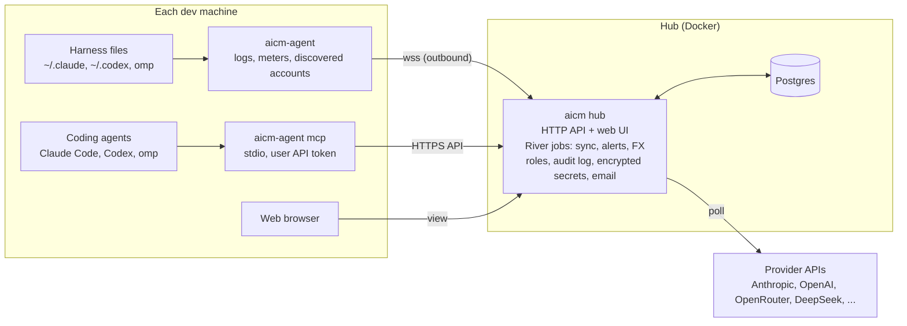

# AI Cost Manager: MVP Plan

Oct 17, 2026 · @Atakan

## Where the plan stands

Revision 3 adds the hosted business model (AGPL hub with a CLA, Apache agent, org-ready schema) on top of revision 2, which keeps the Go, Postgres, goose and sqlc structure, and adds a per-machine agent, provider-native quota meters, built-in secret encryption, email alerts, an audit log, CSV export and currency conversion. The biggest finding: Claude Code and Codex already expose live 5-hour and weekly limits locally, so quota tracking works without handing subscription tokens to the hub.

**Decided**

- React with Vite (no Next.js), shadcn/ui, shadcn charts, Motion, Hairline for illustration, Impeccable as a design review step.
- Opt-in for unofficial quota endpoints; passive capture is the default.
- Roles (admin, editor, viewer) plus per-account grants; email and password, no SSO.
- AGPL-3.0-or-later for the hub; Frankfurter as the default rate source; Google AI Studio instead of Google Cloud; a generated supported-providers table in the README; MIT-licensed projects such as tokscale reused with attribution. Gemini CLI subscription quota stays out unless you say otherwise.
- Major providers first; the rest on community request.
- Email alerts first, other channels later; audit log, CSV export and the scoring rule in v1.

**Open items (placeholders in use until decided)**

1. Contributor terms: the plan assumes a CLA from the first outside pull request (recommended). Not yet confirmed.
2. Agent, MCP server and agent-link protocol license: the plan assumes Apache-2.0 (recommended). Not yet confirmed.
3. Project name: `aicm` is a placeholder for the repo, binaries and Go module path. Pick a name you can register as a trademark before the first public release.

## Your points, answered

| # | Your point | What the plan does now |
| --- | --- | --- |
| 1 | Renewal dates and reminders matter most | Enter plan, price and renewal date once; dates roll forward each cycle; email 7 days and 1 day before with manage and cancel links. Browser automation stays out. See *Alerts*. |
| 2 | Admin keys: fine if one-time | They are one-time: create the key in the provider console, paste it once. They don't expire by default. |
| 3 | Minimal use of subscription tokens | Claude and Codex limits are captured passively by the agent; the hub never holds a subscription token; the one active Claude poll is opt-in, local and rate-limited. See *Subscription quota*. |
| 4 | Several computers must be painless | Beszel-style agent: one pasted command per machine, outbound connection, self-registers, self-updates. One account across five laptops shows once. See *Collector agent*. |
| 5 | Money out is what matters | Money out is the headline (fees, top-ups, invoices); token spend is a secondary view. |
| 6 | Keep quotas as each provider defines them | Each account has provider-defined meters in their own names and units; only the ranking score is derived. See *Quota model*. |
| 7 | Secure secrets, not overcomplicated | Built-in envelope encryption with a master key outside the database and key rotation; Infisical or OpenBao can plug in later. See *Secret storage*. |
| 8 | Billed currency, conversion if easy | Billed currency first; conversion at each charge's date from Frankfurter (default) or ECB (fallback) is small, so it is in v1. See *Money*. |
| 9 | Why balance-only loses history | Those APIs only say "balance now"; past months can't be fetched later, so the hub snapshots hourly from day one. See *Money*. |
| 10 | Major platforms first | MVP has eight provider adapters plus catalog links for the rest; more on community request. |
| 11 | Alerts, audit log, CSV, scoring | All in v1: email alerts with an inbox, append-only audit log, CSV export, and your burn-rate scoring with an hourly 24 h forecast. |

## Business model and licensing

A hosted version on top of an AGPL core works, and it is the Grafana and Plausible model more than the Supabase one: Supabase and ClickHouse use Apache-2.0, which would let a bigger company host your code closed-source. AGPL plus a CLA keeps the community license honest while leaving you, and only you, free to run a hosted version with closed extras or to sell commercial licenses. Three things have to be decided now because they are expensive to change later: the CLA, multi-tenancy in the schema, and the trademark.

**What stays open and what is Cloud**

| Open source (AGPL, self-host free forever) | Cloud (paid) |
| --- | --- |
| Every tracking feature: providers, agents, meters, money out, alerts, MCP, scoring, roles, audit log, CSV | Hosting, upgrades, backups and uptime handled for you |
| Email alerts through your own SMTP | Managed delivery plus push, Slack and Telegram channels without setup |
| One organization per install | Several organizations and teams, per-seat billing |
| History kept as long as your database keeps it | Long retention, usage analytics across teams, spend reports |
| Community support | SSO/SCIM and priority support for companies (later, in a commercial `ee/` folder or a separate service) |

The rule that protects trust: nothing a single person or small team needs is held back from self-host. Cloud sells convenience and team-scale features, the way Supabase sells not having to run Postgres.

**Licensing decisions**

1. **CLA instead of DCO.** With only a DCO, every outside contributor keeps copyright under AGPL, and you could never sell that code under another license; Plausible had to chase past contributors for exactly this. Use CLA Assistant with an Apache-style ICLA from the first outside pull request, and publish a short promise that the core stays AGPL.
2. **Hub under AGPL-3.0-or-later.** It deters a large cloud from reselling it, and as copyright holder you are not bound by it yourself.
3. **Agent, MCP server and agent-link protocol under Apache-2.0.** These run on users' and companies' laptops, and many companies block AGPL binaries on their machines. Grafana keeps its agents Apache for the same reason. It also makes the agent easy for others to integrate.
4. **Trademark.** Register the name and add a short trademark policy; AGPL does not stop someone hosting your unmodified code under your name, a trademark does.
5. **Cloud-only code** lives in separate services (billing, tenant control plane) or a clearly marked `ee/` folder with its own license, never mixed into AGPL files.

**Built in from day one for the hosted version**

- An `org_id` on every tenant table and in every query, with a single default organization for self-host. Retrofitting this later touches every table and handler.
- Per-organization data keys in the secret store, wrapped by a master key that Cloud can move into a KMS. A hosted service that holds customers' admin keys is a high-value target.
- The no-subscription-tokens-on-the-hub rule already fits Cloud: agents send meter readings and usage only, so a hosted hub never touches a Claude or ChatGPT login.

**Reusing other projects.** Everything checked is reusable, with attribution kept in a `THIRD_PARTY_NOTICES.md` that ships in binaries and images. Port logic rather than copying files where you can.

| Project | License | How to use it |
| --- | --- | --- |
| tokscale, ccusage, CodexBar, Claude-Code-Usage-Monitor, ccstatusline, codeburn | MIT | Port harness parsers and quota-probe logic; keep copyright notices |
| LiteLLM `model_prices_and_context_window.json` | MIT (stay out of its `enterprise/` folder) | Seed the model price table |
| Frankfurter, Beszel, Hairline, go-mail, shadcn/ui, Recharts | MIT | Use as dependencies or port patterns |
| Impeccable | Apache-2.0 | Development tool; keep NOTICE if anything is copied |
| River | MPL-2.0 | Unmodified dependency only; edited River files would have to stay MPL |

All of these are permissive, so they don't stop dual licensing later.

## What each provider actually exposes

Only OpenRouter gives usage, cost and balance from one normal key; most others give either an admin-key cost report or a balance, and consumer subscriptions rely on the collector agent or manual entry. Plan the UI so a manual value looks just as good as a fetched one, with a small "manual" or "unofficial" badge.

| Provider | Usage and cost | Balance or quota left | Key needed | Tier |
| --- | --- | --- | --- | --- |
| [OpenRouter](https://openrouter.ai/docs/api/api-reference/credits/get-remaining-credits) | `/api/v1/key` (daily, weekly, monthly), `/api/v1/activity` | `/api/v1/credits` | Normal key; management key for credits and activity | Full |
| [Anthropic API](https://platform.claude.com/docs/en/build-with-claude/usage-cost-api) | `usage_report/messages`, `cost_report` | None, manual | Admin key `sk-ant-admin` | Usage and cost |
| [OpenAI API](https://platform.openai.com/docs/api-reference/usage) | `organization/usage/*`, `organization/costs` | None, manual ([confirmed by OpenAI](https://community.openai.com/t/access-billing-balance-costs-via-admin-api/1383654)) | Admin key `sk-admin` | Usage and cost |
| [xAI API](https://docs.x.ai/developers/rest-api-reference/management/billing) | `billing/teams/{id}/usage`, invoices | `prepaid/balance` | Management key | Full |
| [DeepSeek](https://api-docs.deepseek.com/api/get-user-balance) | None | `/user/balance` | Normal key | Balance |
| [Moonshot / Kimi](https://platform.kimi.ai/docs/api/balance) | None | `/v1/users/me/balance`; coding plan via unofficial `/coding/v1/usages` | Normal key | Balance |
| [SiliconFlow](https://docs.siliconflow.com/en/api-reference/userinfo/get-user-info), Novita, MiniMax | None | user info or balance endpoint | Normal key | Balance |
| [GitHub Copilot](https://docs.github.com/en/rest/billing) | Premium request usage via REST billing API | Unofficial `copilot_internal/user` | PAT with Plan read | Usage and cost |
| [Cursor Teams](https://docs.cursor.com/account/teams/admin-api) | `/teams/daily-usage-data`, `/teams/spend` | None | Team admin key | Usage and cost (teams only) |
| [Google AI Studio](https://ai.google.dev/gemini-api/docs/billing) (Gemini API) | Dashboards only (usage, cost, rate limits); no API | Manual: tier, project spend cap, prepaid credits (snapshot deltas track spend) | None | Manual with deep links |
| Fireworks, Groq | CSV export (Fireworks), Prometheus metrics on Enterprise (Groq) | None | Normal key | Partial |
| Alibaba DashScope | Through Alibaba Cloud BSS | BSS `QueryAccountBalance` | Cloud AccessKey, not the DashScope key | Balance |
| Claude Pro / Max | Local logs only | `Statusline capture by the agent (passive); usage endpoint as opt-in fallback` | None on the hub | Agent capture |
| ChatGPT Plus / Pro (Codex) | Local logs only | `Rollout logs and official app-server, via the agent (passive)` | None on the hub | Agent capture |
| Z.ai GLM Coding Plan | None | Unofficial `monitor/usage/quota/limit` and subscription list (has renewal date) | Normal key | API key quota |
| Mistral, Together, Perplexity, Cohere, Zhipu API balance | None | None | None | Manual |
| Gemini / Google AI Pro, SuperGrok, Perplexity Pro, Cursor Pro | None | None | None | Manual |

Renewal dates and plan prices are manual for every subscription except the Z.ai coding plan. Admin and management keys have org-wide power, so store them encrypted and ask users for read-only scopes where the provider offers them. MiniMax, Novita and the OpenRouter management-key requirement still need a check against the live docs when their adapters are written.

## Subscription quota: how to capture it safely

The good news: Claude Code and Codex both already hand their live limits to local tools, so the core of the product works without touching anyone's token. Claude Code passes the 5-hour and 7-day usage to your statusline script on every render ([documented](https://code.claude.com/docs/en/statusline)), and Codex writes its windows into its session logs and answers `account/rateLimits/read` through its official `codex app-server`. The agent captures these passively; calling private endpoints becomes an opt-in fallback for the few fields they miss.

**Anthropic's rule, quoted from [legal and compliance](https://code.claude.com/docs/en/legal-and-compliance):** "developers may not collect, store, or intermediate Claude.ai credentials or session tokens" and Anthropic "may \[enforce\] without prior notice." So the hub never receives a Claude token, and even the opt-in path runs only on your machine.

| Harness | Primary (passive, no extra calls) | Fallback (opt-in, per account) | What the fallback adds |
| --- | --- | --- | --- |
| Claude Code (Pro, Max) | Statusline wrapper: stdin `rate_limits.five_hour` and `seven_day`, each `used_percentage` (0–100) and `resets_at` (epoch). Plus a `StopFailure` hook with `error: "rate_limit"` as an alert trigger | Agent calls `GET api.anthropic.com/api/oauth/usage` with the local token, at most every 15 min, only when statusline data is over 30 min old, honouring `Retry-After` | Per-model weekly windows (Opus, Sonnet) and extra-usage credits |
| Claude Code headless (`claude -p`, Agent SDK) | `rate_limit_event` in `stream-json` output: status, utilization, `resetsAt` for the binding window | Same as above | Both windows, not just the binding one |
| Codex (ChatGPT plans) | Tail `token_count` events in `~/.codex/sessions/**/rollout-*.jsonl`: `rate_limits.primary` and `secondary` with `used_percent`, `window_minutes`, `resets_at`, plus `credits` and `plan_type` | Agent spawns the official `codex app-server` and calls `account/rateLimits/read` every 10–15 min while idle; never reads `auth.json` | Fresh numbers when Codex hasn't run lately |
| Gemini CLI | Local usage estimates only | Not shipped: Google's terms explicitly ban third-party use of Gemini CLI OAuth | n/a |
| GitHub Copilot | Official billing REST API (AI credits usage) with a fine-grained PAT | `copilot_internal/user` | Remaining quota and reset date directly |
| Z.ai, Kimi, MiniMax coding plans | Hub polls with your own API key every 5–10 min (ordinary credential, low risk) | none needed | n/a |
| Cursor (individual) | Manual entry | Pasted session cookie, hourly | Usage summary |

**How the Claude statusline capture works.** Claude Code allows one `statusLine` command, so the agent installs a tiny wrapper that runs your existing statusline (output unchanged) and appends `{captured_at, five_hour, seven_day}` to a local spool file; the agent ships the spool to the hub. Claude Code refreshes this data after every reply and when a window resets, from response headers it already has. Three caveats: it only exists while you use the interactive app, it has been missing in a few past releases, and a known bug once put the reset epoch into `used_percentage`, so the agent validates ranges and marks readings stale after `resets_at`.

**What this means for staleness.** When you haven't used Claude Code for a while, the last reading still tells the truth until its `resets_at`, after which the window is known to be back at 0%. So passive capture is nearly as good as polling for the two main windows; the opt-in poll is only needed for the per-model weekly bars.

Every reading stores its source (`statusline`, `rollout`, `app_server`, `api`, `manual`) so the UI can show where a number came from. The statusline field needs a check on a live Max account before the parser is finalized.

## Harness import

Every major harness writes token counts to local session files, so import can show real usage for subscriptions even where no API exists. Credentials are a different matter: some sit in plaintext JSON, others in the OS keychain, and Anthropic's terms forbid using a Claude subscription token outside Claude Code. The importer should read logs and account metadata freely, and touch tokens only to identify the plan.

| Harness | Credentials | Plan or account info | Usage logs | Confidence |
| --- | --- | --- | --- | --- |
| Claude Code | macOS Keychain `Claude Code-credentials`; elsewhere `~/.claude/.credentials.json` | `subscriptionType` and `rateLimitTier` in credentials; email in `~/.claude.json` | `~/.claude/projects/*/*.jsonl` and `~/.config/claude/projects/`; dedupe on message id + request id | High |
| Codex CLI | `$CODEX_HOME/auth.json` or OS keyring (newer builds) | `chatgpt_plan_type` in the `id_token` JWT | `$CODEX_HOME/sessions/YYYY/MM/DD/rollout-*.jsonl`, `token_count` events | High |
| omp (oh-my-pi) | `~/.omp/agent/agent.db` (SQLite) and `auth.json`, several providers | Per provider in `agent.db`, schema undocumented | `~/.omp/agent/sessions/**/*.jsonl` | Medium |
| pi | `~/.pi/agent/auth.json`, keyed by provider | Provider keys and OAuth entries | `~/.pi/agent/sessions/*/*.jsonl` with usage and cost | High |
| Gemini CLI | Keychain `gemini-cli-oauth` or `~/.gemini/oauth_creds.json` | Email in `~/.gemini/google_accounts.json`; tier not stored | `~/.gemini/tmp/*/chats/*.json` | High |
| opencode | `~/.local/share/opencode/auth.json` | Provider keys and OAuth entries | `~/.local/share/opencode/opencode.db` (SQLite) | High |
| Kimi Code CLI | `~/.kimi-code/credentials/*.json` | In credentials | `~/.kimi-code/sessions/**/wire.jsonl` | High |
| Cline, Roo, Kilo | VS Code secret storage, encrypted | Not readable | `globalStorage/<extension>/tasks/*/ui_messages.json` with tokens and cost | Medium |
| Crush, Goose, Amp, Qwen Code, Copilot CLI | Mixed: config files, keyring | Varies | SQLite or JSON per tool | Medium |
| Cursor | `state.vscdb` access token | `stripeMembershipType` | No token counts on disk | Medium |
| Aider | `.env`, `.aider.conf.yml` | None | Only `Tokens: … Cost: …` lines in chat history markdown | Medium |

Rules for the importer:

- Read-only on every harness file. Never refresh an OAuth token, since that can rotate the refresh token and log the official client out.
- Store a reference to the credential location plus the derived plan, not the token. Copy plain API keys (for example a DeepSeek key in omp) into the encrypted store only after the user confirms in the import preview.
- Respect path overrides: `CLAUDE_CONFIG_DIR`, `CODEX_HOME`, `PI_CODING_AGENT_DIR`, `GEMINI_CLI_HOME`, `KIMI_CODE_HOME`.
- Handle both `.jsonl` and possibly compressed `.jsonl.zst` Codex rollouts.

Anthropic's [legal and compliance page](https://code.claude.com/docs/en/legal-and-compliance) says developers "may not collect, store, or intermediate Claude.ai credentials or session tokens," and Google's Gemini CLI terms ban third-party use of its OAuth. The importer therefore reads account metadata and logs only, and never ships a subscription token to the hub.

**Prior art you should read before writing parsers:** [tokscale](https://github.com/junhoyeo/tokscale) already parses local logs from about 55 clients, and [ccusage](https://github.com/ryoppippi/ccusage) covers Claude Code, Codex, opencode and pi. CodexBar shows live limits in the macOS menu bar. Your difference is the combination these lack: billing APIs, subscriptions and renewals, multi-user roles and MCP in one self-hosted service.

## Collector agent

Copy [Beszel's](https://beszel.dev/guide/security) outbound WebSocket design: each machine runs a small `aicm-agent` binary that dials the hub, so adding the fifth laptop is one pasted command and nothing on the hub side. Beszel is MIT, so its patterns can be reused freely.

**Enrolling a machine**

1. In the hub, open *Machines → Add* and copy the one-liner. It embeds the hub URL, the hub's public key and a **universal token** (valid 1 hour by default, or saved as permanent). Variants: `curl | sh` for Linux and macOS, Homebrew, a PowerShell script for Windows, or Docker.
2. The script installs the binary as a **user-level** service (launchd agent on macOS, `systemd --user` on Linux, a logon task on Windows). It runs as you, not root, because it has to read `~/.claude` and `~/.codex`.
3. The agent connects out to `HUB_URL/api/agent/connect` and sends the token. The hub signs it, and the agent checks the signature against the hub key, which proves it is talking to your hub.
4. The agent sends a fingerprint (a hash of the machine id, stored in its data dir). The hub creates the machine on first contact and rejects a different fingerprint later.

**What it does once connected**

- Runs the harness importers and shows them in the hub as *discovered accounts* for you to confirm, so nothing is added silently.
- Tails session logs with a cursor per file (path, inode, offset) and pushes only new usage. The hub dedupes on machine + source + message id, so restarts never double-count.
- Captures subscription meters the way the quota deep dive describes, and pushes `MeterReading`s.
- Updates itself daily from GitHub releases, and reconnects with backoff after sleep or network changes.
- Ships `aicm-agent mcp`, so the same install gives your local agents the MCP server with no extra token setup.

**Same account on several machines.** The hub identifies a subscription by the provider's own account id (the Claude account UUID from `~/.claude.json`, the ChatGPT account id in the Codex token), not by machine. Usage from all machines is summed into one account, and for meters the newest reading wins. Five laptops on one Claude Max plan show as one account with one set of meters.

SSH mode (hub connects to the agent) is left out, because laptops behind NAT can't accept inbound connections.

## Quota model and scoring rule

Quotas stay exactly as each provider defines them: every account has a set of **meters**, each with the provider's own name, unit and reset rule. Nothing is converted into a common unit for display. The only shared math is a derived headroom number used for ranking, and it never replaces the provider's own figures on screen.

| Provider (example) | Meters as the provider defines them | Unit | Resets |
| --- | --- | --- | --- |
| Claude Max | 5-hour, 7-day; per-model weekly only with the opt-in poll | percent used | rolling 5 h, fixed weekly time |
| ChatGPT Pro (Codex) | Primary window, Secondary window | percent used | window minutes reported by Codex |
| Z.ai GLM Coding Plan | Prompts per 5 hours, monthly tool calls | count | 5 h, monthly |
| GitHub Copilot | AI credits | count | 1st of the month |
| OpenRouter | Credits, per-key limit | USD | never (top-up), or key reset |
| DeepSeek | Balance (topped-up and granted shown separately) | CNY or USD | never |

Two tables hold this: `quota_meters` (account, provider meter key, label, unit, reset rule, limit if known) and `quota_readings` (meter, used, remaining, limit, resets\_at, captured\_at, source). A provider adapter or the collector agent declares the meters; the UI renders them in the provider's own words, with a progress bar only when a limit is known.

**Scoring rule for agents.** Your idea is the right one: compare what is left against how fast it is being used, up to the next reset. For each meter *m*:

- burn rate *b* = recent consumption per hour (moving average of the deltas between readings, in the meter's own unit)
- time to empty *T\_empty* = remaining ÷ *b*
- time to reset *T\_reset* (for balances with no reset, use 30 days)
- **headroom** = min(1, *T\_empty* ÷ *T\_reset*): 1 means it lasts until reset at the current pace, 0.3 means it runs dry 70% of the way there
- **expiring** = max(0, remaining − *b* × *T\_reset*) ÷ limit: the share of a subscription window that will be wasted if you don't use it

An account's score is its weakest meter's headroom (one exhausted meter blocks the account). Accounts are ranked by: can it take the job at all, then most expiring quota first (use what you'd lose anyway), then lowest marginal cost (flat-rate subscriptions are 0, metered accounts are priced from the model price table), then highest headroom. Because *b* and *T\_reset* are known, the same formula projects forward, so `forecast_capacity` returns the score hour by hour for the next 24 hours and an agent can plan when to run heavy work.

Every recommendation returns its reasons ("Claude Max: 62% of the weekly window expires in 31 h unused") so the ranking is never a black box.

## Secret storage

Build the encryption into the hub and skip Infisical for v1. Infisical would roughly double what you run (its own backend plus Postgres and Redis, 4 GB RAM minimum) and still depends on its own master key, so it moves the problem rather than removing it. n8n and LiteLLM use the same built-in pattern recommended here.

| Option | Security | Extra infra | Fit for a solo maintainer |
| --- | --- | --- | --- |
| **Built-in envelope encryption** | Strong if the master key stays out of the database | None | **Recommended for v1** |
| [Infisical](https://github.com/Infisical/infisical) self-hosted | Strong | Backend + Postgres + Redis | Optional backend later |
| OpenBao (open Vault fork) | Strongest, with policies and audit | Server with unseal steps | Optional backend later |
| SOPS | Good for files in git | None | Wrong fit: secrets come in through the UI |

**How the built-in store works**

- Each secret gets its own random data key and is encrypted with XChaCha20-Poly1305. The data key is wrapped by a master key read from `AICM_MASTER_KEY` or `AICM_MASTER_KEY_FILE` (works with Docker secrets).
- Each row stores a key version, so `aicm rotate-key` can re-wrap every data key without downtime. The row id is bound as associated data, so a ciphertext copied onto another row fails to decrypt.
- Secrets are write-only: the API and UI show only the last four characters, and MCP tools never return them. Decryption happens only inside the sync worker, just before a request.
- The master key is never in Postgres or in backups of it. The README must state plainly that losing the master key means re-entering every key.
- Agents never send harness OAuth tokens to the hub; those stay on the machine (see Collector agent).
- A small `SecretStore` interface keeps the door open to OpenBao or Infisical later without touching callers.

## Money: currency, conversion and balance history

Money out is the headline number, always shown in the currency the provider bills in; conversion to one display currency is cheap enough to ship in v1 as a secondary figure.

**What counts as money out.** One `charges` table holds every payment, in its billed currency:

- Subscription fees: created automatically on each renewal date from the plan price and cycle, so a yearly total needs no typing after setup.
- Wallet top-ups: entered by hand, or suggested automatically when a balance jumps up (below).
- Invoices: pulled where an API exposes them (xAI invoices, Anthropic and OpenAI cost reports for postpaid accounts).

Token spend (usage × price) is kept as a separate, secondary view.

**Currency conversion.** Rates come through a small `RateSource` interface with two built-in sources. The default is [Frankfurter](https://frankfurter.dev): free, no key, open source (MIT), 200+ currencies, and self-hostable with one Docker container if you'd rather not call a public API. The fallback is the [ECB daily reference rates](https://www.ecb.europa.eu/stats/eurofxref/eurofxref-daily.xml), about 30 currencies including CNY. A job stores one rate per currency per day in `fx_rates`, and each charge converts at the rate of its own date, so last March's total doesn't change when the yuan moves. The UI shows `¥100.00 (≈ $13.90)`, billed amount first. This is roughly one task of work, so it is in v1.

**Why balance-only providers lose history.** DeepSeek, Moonshot and SiliconFlow answer one question: "what is the balance right now?" They have no endpoint for "what was it on 1 September" or "what did I spend in August". If nothing reads the balance during August, August's spend can never be reconstructed later, unlike Anthropic or OpenAI, whose cost reports can be fetched for any past range. So the hub reads these balances on a schedule (hourly is plenty) and keeps every reading:

- spend in a period = balance at start − balance at end + top-ups during it
- a reading that goes up is a top-up; the hub records it as a suggested charge for you to confirm (DeepSeek reports topped-up and granted balance separately, so free grants are not mistaken for payments)
- the history starts the day you connect the account, which the UI says plainly

For admin keys (Anthropic, OpenAI, xAI): creating one is a **one-time** step in the provider's console, pasted into the hub once. These keys don't expire by default, so no recurring action is needed unless you revoke one.

## Alerts, audit log and CSV export

All three are in v1. Alerts go out by email first, through a `Notifier` interface so Slack, Telegram or ntfy can be added later without touching alert logic.

| Alert | Fires when | Default |
| --- | --- | --- |
| Renewal coming | A subscription renews soon; includes price, card-charge date, and manage and cancel links | 7 days and 1 day before |
| Trial or promo ending | A plan marked as trial or discounted reaches its end date | 3 days before |
| Low balance | A wallet drops below a threshold, or will run out within N days at the current burn rate | below 20%, or under 7 days left |
| Meter nearly exhausted | A subscription window passes a threshold before it resets | 90% used |
| Quota going to waste | A window resets soon with a large share unused (from the scoring rule) | over 50% unused, 12 h before reset |
| Sync failing | An adapter or agent has failed for a while, so the numbers are stale | 24 h |
| Agent offline | A machine has not reported for a while | 48 h |

Each rule can be changed or snoozed per account. Every alert is also listed in an in-app inbox, and each email is sent once per event: the job that sends it uses a uniqueness key, so restarts never send duplicates.

**How it runs.** [River](https://github.com/riverqueue/river), a job queue that lives in the same Postgres, runs every scheduled job (polling, renewals, FX refresh, alert checks) with retries and uniqueness built in. Mail goes out over SMTP with [go-mail](https://github.com/wneessen/go-mail), which covers Gmail, Fastmail, Resend, Postmark and any other SMTP relay in v1.

**Audit log.** Every write records who did it (user, API token or agent), what changed (a before and after diff, secrets redacted) and when. Admins see it in the UI; it is append-only and never edited.

**CSV export.** Charges, usage and meter readings export from any table view with the current filters, and from `GET /api/export/{charges|usage|readings}.csv` for scripts.

## MVP scope

The MVP is done when you can enroll every laptop with one command, see every subscription's renewal date and every live quota meter on one screen and through MCP, get an email before anything renews or runs out, and see this month's and this year's money out per provider.

**In the MVP**

- Hub in Docker with Postgres; email and password login; admin, editor and viewer roles with per-account grants; audit log.
- `aicm-agent` with universal-token enrollment, self-update, and importers for Claude Code, Codex and omp (discovered accounts, usage logs, meter capture).
- Claude meters from the statusline wrapper and Codex meters from rollout logs and `codex app-server`; the Claude usage-endpoint poll as an opt-in, per account.
- Hub adapters for the major providers: OpenRouter, Anthropic API, OpenAI API, xAI, DeepSeek, Moonshot, Z.ai coding plan, GitHub Copilot.
- Manual accounts and meters for everything else, including Google AI Studio (tier, spend cap, prepaid credits, with links to its usage, spend and billing pages), and a full provider catalog of top-up, billing and cancel links.
- Money out: subscription fees auto-created on renewal, top-ups (manual or detected from balance jumps), billed currency first, ECB conversion second.
- Alerts by email (renewals, low balance, meters, quota going to waste, sync failures, offline agents) plus an in-app inbox.
- Scoring rule, `recommend_account` and `forecast_capacity` in MCP; CSV export.
- Encrypted secret store with key rotation.

**Not in the MVP**

| Left out | Why | When |
| --- | --- | --- |
| Slack, Telegram, ntfy alerts | Email first, through the `Notifier` interface | Next |
| Browser automation to cancel or top up | You chose reminders plus one-click links first | Later, if ever |
| SSO / OIDC | Not needed for a self-hosted tool | Not planned |
| Infisical or OpenBao backends | Built-in store is enough | On request |
| Gemini quota | Google bans third-party OAuth use; local estimates only | Only if Google offers an official route |
| Cursor individual usage | Needs a pasted session cookie | Opt-in, after MVP |
| Long-tail providers (Mistral, Together, Groq, and more) | Catalog links and manual entry cover them | When the community asks |
| Desktop app | Web covers it | Optional |
| Budgets and forecasts of spend | Needs months of history first | After MVP |

## Stack and UI

Web app first, React with Vite, no Next.js. Next only pays off with server rendering or SEO, and this is a logged-in dashboard served from the Go binary; Vite builds static files that `go:embed` serves from the same container. A desktop shell (Wails, which reuses this UI) stays optional for later.

| Layer | Choice | Why |
| --- | --- | --- |
| Build | Vite + React + TypeScript | Static build, embedded in the Go binary |
| Components | [shadcn/ui](https://ui.shadcn.com) | Clean, owned source, the Flash models know it well |
| Charts | [shadcn charts](https://ui.shadcn.com/docs/components/chart) (Recharts v3) | Uses the same theme tokens as the components |
| Motion | [Motion](https://motion.dev/docs/react) (`motion/react`) | Small, tree-shakable; for meters filling and panel transitions only |
| Illustration | [Hairline](https://github.com/lucasmarkes/hairline) | Pointer-reactive line art, installed through the shadcn registry and themed by its tokens; use for empty states and the login screen |
| Data | TanStack Query + a client generated from the OpenAPI spec | Typed calls, caching, no hand-written fetch code |
| Routing | React Router | A handful of routes; nothing heavier needed |

[Impeccable](https://github.com/pbakaus/impeccable) is a design-review skill for coding agents, not a runtime library. Run its `critique` and `polish` commands as part of Opus's verification step on every UI task, so the Flash models' screens get the same review.

**Screens in v1:** Overview (money out this month and year, by provider), Quotas and renewals (one card per account, provider-native meters, one-click links, sorted by urgency), Account detail, Usage, Alerts inbox, Machines (enrolled agents), Settings (users and grants, SMTP, currency, audit log). The look stays quiet: neutral palette, one accent for urgency, dense but readable cards.

## Architecture and repo layout

Two binaries from one Go module: `aicm`, the hub (API, UI, jobs) in Docker next to Postgres, and `aicm-agent`, installed once per machine. Packages are split by feature, each holding its types, service and queries, which keeps the code close together without DDD layers.



Agents dial out to the hub over WebSocket and keep harness tokens on the machine; only the hub stores provider keys and polls their APIs.

**Libraries:** standard `net/http` routing, `pgx` + `sqlc`, `goose` migrations, River for jobs, go-mail for SMTP, `slog`, the official MCP Go SDK, `coder/websocket` for the agent link. No ORM, no DI framework.

**Access:** three roles (admin, editor, viewer) plus per-account grants to a user or group. Admins see everything; others see only granted accounts. Email and password login, API tokens for MCP and scripts, no SSO in the open core. Every tenant table carries an `org_id` (a single default organization when self-hosted), so the hosted version needs no schema rewrite.

```text
aicm/
  cmd/
    aicm/                 # hub: serve, migrate, rotate-key, create-admin
    aicm-agent/           # agent: run, enroll, mcp, update
  internal/
    config/  httpapi/  db/      # env, router + handlers, sqlc output
    auth/                       # users, sessions, tokens, roles, grants
    secrets/                    # envelope encryption, SecretStore interface
    account/                    # accounts, plans, renewals
    charge/                     # money out: fees, top-ups, invoices
    usage/                      # token usage and rollups
    quota/                      # meters, readings, scoring, forecast
    alert/                      # rules, inbox, Notifier, email
    fx/  pricing/  audit/       # rates, model prices, audit log
    jobs/                       # River workers: sync, alerts, FX, renewals
    agentlink/                  # WebSocket protocol shared by hub and agent
    provider/                   # interface, registry, HTTP client
      anthropic/ openai/ openrouter/ xai/ deepseek/ moonshot/ zai/ ...
    harness/                    # used by the agent
      claudecode/ codex/ omp/ ...
    mcpserver/                  # MCP tools over the API client
  migrations/  web/  deploy/  docs/
```

| Table | Purpose |
| --- | --- |
| `users`, `groups`, `group_members`, `account_grants`, `api_tokens` | Who can see and change what |
| `machines`, `enroll_tokens` | Enrolled agents, fingerprints, universal tokens |
| `accounts`, `secrets` | One login or key at a provider; its encrypted credential |
| `quota_meters`, `quota_readings` | Provider-native meters and every reading |
| `charges`, `fx_rates` | Money out in billed currency; daily rates |
| `usage_daily` | Tokens and estimated cost per account, day, model |
| `alert_rules`, `alerts` | Rules per account and the inbox |
| `audit_log` | Append-only record of every change |

Providers stay a catalog in code, so links and meter definitions ship with the binary. Every swappable part sits behind a small interface with one built-in implementation: `Provider`, `Harness`, `RateSource` (Frankfurter by default, ECB fallback), `PriceSource` (LiteLLM price file), `Notifier` (SMTP first) and `SecretStore` (built-in first, OpenBao or a cloud KMS later).

## Provider adapter model

Every provider is one package that declares its links, its meters and what it can fetch; the sync engine only calls what is declared. A provider with no API is still a full citizen: a catalog entry with links and manual meters.

```go
// internal/provider/provider.go
type Info struct {
    ID         string     // "openrouter"
    Name       string
    Currency   string     // currency the provider bills in
    AuthKinds  []AuthKind // APIKey, AdminKey, AgentCapture, None
    Links      Links      // TopUp, Billing, ManageSubscription, Usage, Keys
    Meters     []MeterDef // provider-defined quota meters (key, label, unit, reset rule)
    Unofficial bool       // relies on an undocumented endpoint
}

type Provider interface {
    Info() Info
    Validate(ctx context.Context, c Credentials) error
}

// Optional, implemented only when the provider supports it.
type UsageFetcher interface {
    FetchUsage(ctx context.Context, c Credentials, from, to time.Time) ([]UsageRecord, error)
}
type QuotaFetcher interface {
    FetchQuota(ctx context.Context, c Credentials) ([]MeterReading, error)
}
type ChargeFetcher interface { // invoices, top-ups, if the API exposes them
    FetchCharges(ctx context.Context, c Credentials, since time.Time) ([]Charge, error)
}
```

Three record types cross the boundary: `UsageRecord` (day, model, tokens, requests, cost in billed currency, source), `MeterReading` (meter key, used, remaining, limit, resets\_at, source) and `Charge` (amount, currency, date, kind: subscription, top-up, invoice). `MeterReading` carries the provider's numbers untouched.

Rules that keep adapters small enough for a Flash model:

- One package per provider under `internal/provider/<id>/`, one line in `registry.go`.
- All HTTP goes through a shared client with timeouts, backoff, a per-provider minimum poll interval and a fixture recorder.
- Each adapter has one golden test: recorded JSON in, expected records out.
- MVP covers the major providers only; the long tail is added when the community asks, and simple balance endpoints can use a declarative YAML file instead of Go code.

Subscription meters that come from a harness (Claude Code, Codex) are not fetched by the server. The collector agent captures them on the machine where the harness runs and pushes `MeterReading`s with `source = agent`; see the quota deep dive above.

## MCP tool surface

The MCP server is `aicm mcp`, a stdio process built on the official [Go MCP SDK](https://github.com/modelcontextprotocol/go-sdk). It calls the hub's HTTP API with a personal API token, so it inherits that user's role and grants, and every write lands in the audit log under that user. The hub also serves the same tools over streamable HTTP at `/mcp` for agents that are not on a machine with the agent installed.

| Tool | Kind | What it returns or does | Role |
| --- | --- | --- | --- |
| `list_accounts` | read | Accounts with provider, kind, plan, billed currency, last sync | viewer |
| `get_quotas` | read | Every meter in the provider's own terms, with remaining, resets\_at, headroom and expiring share | viewer |
| `recommend_account` | read | Accounts ranked for a job (model family, rough size, horizon), with reasons | viewer |
| `forecast_capacity` | read | Score per account hour by hour for the next 24 h | viewer |
| `list_renewals` | read | Subscriptions renewing within N days, price, manage and cancel links | viewer |
| `get_spend` | read | Money out per month or year, per provider, in billed currency and optionally converted | viewer |
| `get_usage` | read | Tokens, requests and estimated cost by provider, account, model or day | viewer |
| `get_links` | read | Top-up, billing and cancel URLs for an account | viewer |
| `add_account` | write | Manual account: provider, plan, price, cycle, renewal date | editor |
| `update_account` | write | Plan, price, renewal date, notes, manual meter values | editor |
| `record_charge` | write | Log a top-up or subscription payment | editor |
| `sync_account` | write | Fetch now (respects the provider's minimum poll interval) | editor |
| `snooze_alert` | write | Silence one alert until a date | editor |
| `archive_account` | write | Hide an account; requires `confirm: true` | admin |

No tool deletes data, and no tool can read or return a secret.

## Open source setup

The hub is AGPL-3.0-or-later; the agent, MCP server and agent-link protocol are Apache-2.0; contributors sign a CLA. Releases install in one command, and the README always shows which providers are supported. The reasoning is under *Business model and licensing*.

- **License files:** AGPL text in the root `LICENSE`, Apache-2.0 in `cmd/aicm-agent/`, `internal/agentlink/` and `internal/mcpserver/`, and an SPDX header on every file checked by REUSE lint in CI. A footer link to the source and version in the UI keeps forks compliant with AGPL's network clause.
- **Contributions:** CLA Assistant on every pull request, `CONTRIBUTING.md` (how to add a provider in one package or YAML file, how to record a fixture), Conventional Commits.
- **Attribution:** `THIRD_PARTY_NOTICES.md` lists every ported or bundled project and ships in binaries and images.
- **Community files:** `README`, `SECURITY.md` (private reports through GitHub Security Advisories), `CODE_OF_CONDUCT.md`, `TRADEMARKS.md`, issue templates (bug, new provider), PR template, `CHANGELOG.md`.
- **Supported providers table:** generated from the provider catalog in code by `aicm providers --markdown` into the README between marker comments. CI fails if the README is out of date, so the table can never drift from what the binary supports. Columns: provider, usage, money out, quota meters, how it is captured (API, agent, manual), links.
- **Releases:** GoReleaser builds the hub image for amd64 and arm64 to GHCR, `aicm-agent` binaries for macOS, Linux and Windows, a Homebrew tap, checksums and an SBOM. SemVer; the agent self-updates from these releases.
- **Provider requests:** a "new provider" issue template asks for the docs link, auth type and a sample response, which doubles as the task card for a Flash model.

## Build order and delegation

Opus writes the contracts (schema, API spec, adapter and agent-link interfaces, task cards) and the Flash models fill in one package at a time against them. No Flash task invents a new package or abstraction.

**How each task is handed off**

1. Opus writes `docs/tasks/NN-name.md`: goal, files to touch, the interface or SQL to satisfy, one existing file to copy from, and the done check.
2. A Flash model implements it on its own branch, touching only the listed files, ideally under 300 changed lines.
3. Opus verifies: `go build`, `go vet`, `golangci-lint`, `sqlc generate` leaves no diff, required tests pass, the diff stays in the listed files. UI tasks also get an Impeccable `critique` pass.
4. One Flash model per area keeps style consistent, for example DeepSeek on Go packages and GLM on the React app.

| # | Phase | Task | Writer | Needs | Done when |
| --- | --- | --- | --- | --- | --- |
| 1 | Contracts | Repo skeleton, both `cmd/` binaries, config, Dockerfile, Compose, license files, CI with REUSE and CLA checks | Opus | none | `docker compose up` serves a health check |
| 2 | Contracts | Migrations for all tables with org\_id, sqlc config, River setup | Opus | 1 | `migrate up` runs clean |
| 3 | Contracts | OpenAPI spec for UI, MCP and export endpoints | Opus | 2 | Spec lints; Go and TS types generate |
| 4 | Contracts | Provider, harness, `MeterDef` and `MeterReading` types; shared HTTP client with fixture recorder | Opus | 1 | A fake adapter passes a golden test |
| 5 | Contracts | `agentlink` protocol: enroll, handshake, message types | Opus | 1 | Spec doc plus a loopback test |
| 6 | Core | `secrets`: envelope encryption, key versions, `rotate-key` | Flash | 2 | Round-trip and rotation tests pass |
| 7 | Core | `auth`: users, sessions, tokens, roles, grants | Flash | 2, 3 | Viewer cannot read an ungranted account (test) |
| 8 | Core | `audit` writes on every mutation, admin view endpoint | Flash | 7 | Each write leaves one row |
| 9 | Core | `account` CRUD, plans, renewal roll-forward | Flash | 7 | Roll-forward test passes |
| 10 | Core | `charge`: fees on renewal, top-ups, top-up detection from balance jumps | Flash | 9 | Money-math tests pass |
| 11 | Core | `fx`: ECB fetch job, rate-at-date lookup | Flash | 2 | Known date converts correctly (test) |
| 12 | Core | `usage` rollups and `pricing` table import | Flash | 2 | Aggregation test passes |
| 13 | Core | `quota`: meters, readings, staleness, scoring, forecast | Opus | 4 | Scoring cases agree with the written rule |
| 14 | Core | `alert`: rules, inbox, go-mail notifier, River jobs with uniqueness | Flash | 9, 13 | One email per event under restarts |
| 15 | Hub sync | Adapters: OpenRouter, DeepSeek, Moonshot (one task each) | Flash | 4 | Golden test passes |
| 16 | Hub sync | Adapters: Anthropic Admin, OpenAI Admin, xAI (one task each) | Flash | 4 | Golden test passes; paging handled |
| 17 | Hub sync | Adapters: Z.ai coding plan, GitHub Copilot billing (one task each) | Flash | 4 | Golden test passes |
| 18 | Agent | Agent core: enroll, WebSocket link, reconnect, spool, self-update | Flash | 5 | Survives hub restart; no duplicate pushes |
| 19 | Agent | Install scripts (sh, Homebrew, PowerShell) as user-level services | Flash | 18 | Fresh macOS and Linux installs enroll |
| 20 | Agent | `harness/claudecode`: discover, tail logs, statusline wrapper that chains the user's own | Flash | 18 | Sample log and sample stdin parse to expected rows |
| 21 | Agent | `harness/codex`: rollout tailing and `codex app-server` rate-limit reads | Flash | 18 | Sample rollout parses; app-server read works locally |
| 22 | Agent | `harness/omp` | Flash | 18 | Sample session parses |
| 23 | Agent | Opt-in Claude usage poll with cache, backoff, 15-minute floor | Flash | 20 | Off by default; respects `Retry-After` |
| 24 | UI | Shell, login, theme, generated client, Hairline on empty states | Flash | 3 | Login works |
| 25 | UI | Quotas and renewals page with provider-native meters and one-click links | Flash | 13, 24 | Sorted by urgency; links open provider pages |
| 26 | UI | Overview: money out by month and year, billed and converted | Flash | 10, 11, 24 | Matches API totals |
| 27 | UI | Accounts, account detail, usage, discovered-account review | Flash | 9, 24 | Viewer sees no edit controls |
| 28 | UI | Alerts inbox, Machines page, Settings (users, grants, SMTP, currency, audit log) | Flash | 14, 18, 24 | All settings save |
| 29 | MCP | `aicm-agent mcp` and hub `/mcp` with every tool | Flash | 3, 13 | Works from Claude Code; viewer blocked on writes |
| 30 | Release | GoReleaser: GHCR images, agent binaries, Homebrew tap, SBOM | Opus | 19 | Snapshot release installs end to end |
| 31 | Catalog | Links and manual meters for every provider in the table | Flash | 4 | Every listed provider has links |
| 32 | Release | README supported-providers table generated from the catalog, plus CI drift check; THIRD\_PARTY\_NOTICES | Flash | 31 | CI fails when the README table is stale |

Tasks 6 to 12 run in parallel after the contracts land, and 15 to 28 run in parallel after that. Tests are written only where the last column asks: crypto, permissions, money math, scoring, parsers and adapters.
