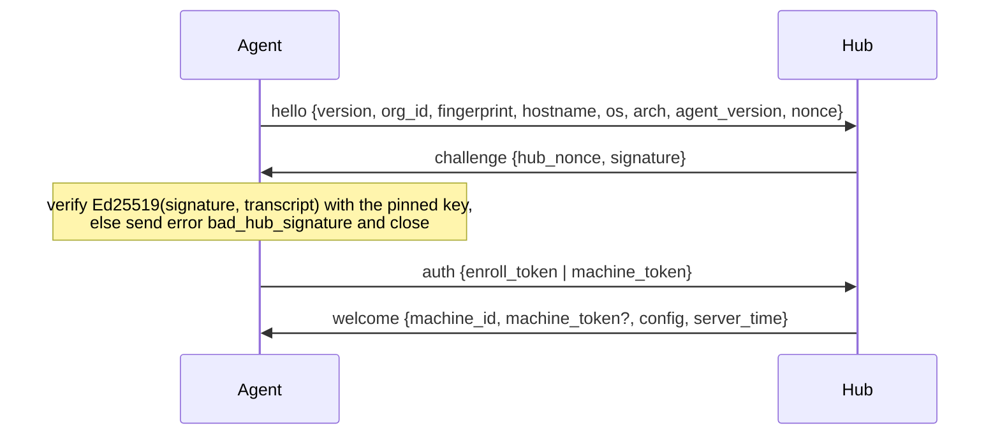

# agentlink protocol, version 1

The link between `aicm-agent` and the hub. Go types in `internal/agentlink` are the source of truth; this page explains them.

## Transport

- The agent dials `wss://<hub>/api/agent/connect` with WebSocket subprotocol `aicm.agentlink.v1`. Plain `ws://` is allowed only to loopback addresses (development). The hub rejects an upgrade without the subprotocol.
- Every frame is a UTF-8 JSON text message holding one envelope: `{"type": "...", "id": "<128-bit hex>", "payload": {...}}`.
- Limits: 1 MiB per message, 1000 items per batch. Liveness uses WebSocket ping frames from the hub every 30 s; the agent reconnects with exponential backoff (1 s doubling to 5 min, ±20% jitter) after any close.

## Enrollment command

*Machines → Add* creates a universal enroll token (`aicm_et_…`, 1 hour by default, or permanent) and shows a one-liner carrying four values: hub URL, org id, hub public key (base64 Ed25519) and the token. The agent stores the URL, org id and key in its config and **pins** the key.

## Handshake

- `transcript = "aicm.agentlink.v1\n" + org_id + "\n" + fingerprint + "\n" + nonce + "\n" + hub_nonce`. Nonces are 32 random bytes, base64. Binding both nonces and the fingerprint stops a signature being replayed to another agent or connection.
- The agent sends its credential only after the signature checks out, so an impostor hub never sees it.
- `fingerprint = hex(sha256("aicm-agent-fingerprint\0" + machine_id))`, where `machine_id` is the OS's stable id (`/etc/machine-id`, `IOPlatformUUID`, `MachineGuid`).
- **Enroll token:** the hub creates the machine (or, for a known fingerprint, rotates its token) and returns `machine_token` (`aicm_mt_…`). The agent writes it to its data dir with mode 0600 and uses it on every later connection.
- **Machine token:** the hub checks the stored fingerprint and rejects a mismatch with `fingerprint_mismatch`, or a revoked machine with `machine_revoked`.
- The hub stores only `sha256(token)` for both token kinds.
- The whole handshake must finish in 15 s.

On failure either side sends `error {code, message}` and closes with status 1008. Codes: `bad_message`, `unsupported_version`, `unauthorized`, `fingerprint_mismatch`, `machine_revoked`, `bad_hub_signature`, `internal`, `too_large`, `handshake_timeout`.

## After the handshake

| Type | Direction | Payload | Hub reply |
| --- | --- | --- | --- |
| `accounts` | agent → hub | Full snapshot of discovered accounts | `ack` |
| `usage` | agent → hub | Batch of `UsageEvent` | `ack` |
| `meters` | agent → hub | Batch of `MeterReport` (definition + reading) | `ack` |
| `status` | agent → hub | Harness health | `ack` |
| `secret_reply` | agent → hub | Answer to a `secret_request` | `ack` |
| `config` | hub → agent | `AgentConfig` whenever it changes | none |
| `secret_request` | hub → agent | Plain API key wanted for one account | `secret_reply` |
| `ack` | hub → agent | `{id, error?}` for a received envelope id | none |

**Delivery.** At least once. The agent writes each outgoing data message to a spool file under its envelope id before sending, and deletes it when the matching `ack` arrives. After a reconnect it resends unacked messages with the **same id**. The hub acks only after the database commit, and dedupes on natural keys: usage on `(machine, source, message_id)`, readings on `(meter, captured_at, source)`. An `ack` with `error` means the hub rejected the message for good; the agent logs it and drops it.

**Accounts.** Accounts are identified by `AccountRef {provider_id, external_id}`: the Claude account UUID, the ChatGPT account id, or for a plain API key `key:` + the first 16 hex characters of its SHA-256. A new ref creates a `pending` account on the hub, shown in the discovered-accounts review; data for it is stored right away so nothing is lost before confirmation. `config.accounts[].status = dismissed` tells the agent to stop sending data for that account.

**Meters.** Every `MeterReport` carries its `meter.Def`, because agent-captured meters are defined by what the harness reports (Codex window lengths can change). The hub upserts the definition and stores the reading untouched. The agent validates readings before sending (`meter.Reading.Validate`), which drops impossible values such as an epoch in a percent field.

**Secrets.** Subscription OAuth tokens never cross this link. `secret_request` is only sent after a user confirmed "import key" for an account the agent reported with `auth_kind: api_key` and `has_api_key: true`; the agent refuses any other request.

**Opt-in polls.** `config.accounts[].allow_unofficial` enables the Claude usage endpoint poll for that account on this machine: at most every 15 minutes, only when the statusline reading is over 30 minutes old, honouring `Retry-After`.
